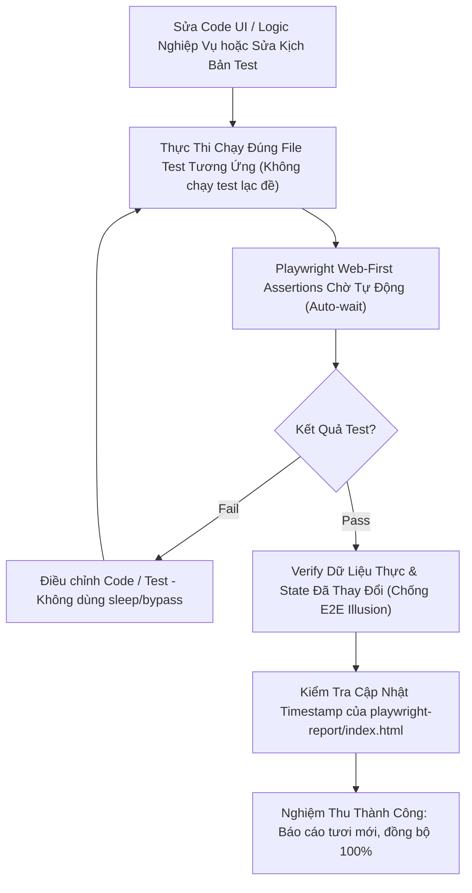
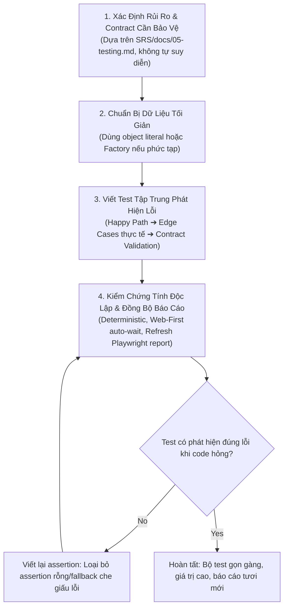

# Workflow: Resilient & High-ROI Testing (`resilient-testing-workflow`)

Skill này hướng dẫn phương pháp thiết kế và lập trình các bộ kiểm thử tự động (Unit, Contract, State Machine, Component, Playwright E2E) sao cho **tập trung tối đa vào các rủi ro sống còn (High-ROI)**, **ngăn chặn AI over-engineering / viết test sai mục đích**, **hạn chế tối đa việc test bị gãy hoặc phải sửa lại khi tái cấu trúc code (Anti-Fragile & Minimal Maintenance)**, và **bảo đảm tính trung thực, đồng bộ tuyệt đối của báo cáo kiểm thử (Anti-Report Illusion)**.

---

## 1. Nguyên Tắc Cốt Lõi (Core Principles)

> **"Chỉ viết test khi xác định được rủi ro cần bảo vệ, contract cần xác minh hoặc hành vi nghiệp vụ cần kiểm chứng. Expected result phải có căn cứ. Ưu tiên số lượng test ít nhưng có giá trị phát hiện lỗi cao, dễ bảo trì và không phụ thuộc implementation detail không cần thiết."**

### A. Bốn (4) Ưu Tiên Cao Nhất (Top 4 Priorities)
1. **Không để AI tự suy diễn nghiệp vụ**: Tuyệt đối không tự suy luận quy tắc, công thức tính hay trạng thái nếu không có trong SRS hoặc tài liệu đã xác nhận.
2. **Không để test che giấu lỗi bằng fallback**: Sai contract API hoặc thiếu trường bắt buộc phải fail rõ ràng để phát hiện bug; không dùng test để hợp thức hóa fallback âm thầm che đậy lỗi của backend/frontend.
3. **Không viết test chỉ để tăng coverage**: Tránh viết các test vô bổ, rỗng hoặc chạy "luôn pass" chỉ nhằm làm xanh chỉ số báo cáo CI.
4. **Không tạo thêm chi phí bảo trì không cần thiết**: Tránh premature abstraction, hạn chế mock chi tiết cài đặt nội bộ, giữ test ngắn gọn, rõ ràng và phục vụ đúng mục đích bảo vệ nghiệp vụ.

### B. Tám (8) Điểm Điều Chỉnh Kỹ Thuật Bắt Buộc
1. **Edge Case Matrix theo rủi ro thực tế**: Test biên theo các tình huống có khả năng xảy ra trong thực tế (dữ liệu thiếu, định dạng sai lệch thực tế, mạng chập chờn). Không bắt buộc ép mọi giá trị rác vô lý nếu không có nguy cơ xảy ra trong thực tế.
2. **Factory thực tế & tránh Premature Abstraction**: Chỉ tạo Factory khi cấu trúc dữ liệu thực sự phức tạp hoặc được tái sử dụng qua nhiều test. Với dữ liệu đơn giản hoặc dùng 1 lần, ưu tiên dùng object literal cục bộ để giữ code gọn gàng, dễ hiểu.
3. **Deterministic & Không lãng phí thời gian chờ**: Bỏ các giới hạn thời gian cứng (< 1-2s). Trọng tâm là tính độc lập, deterministic (zero-network, freeze time tĩnh) và không lãng phí thời gian chờ vô ích (`setTimeout` dài).
4. **Mapper & Contract Validation minh bạch**: Khi backend gửi sai contract hoặc thiếu trường bắt buộc, mapper/test phải báo lỗi hoặc fail assertion tương ứng để phát hiện sớm bug tích hợp; không dùng test để bao biện cho cơ chế fallback âm thầm nuốt lỗi.
5. **Black-box kết hợp kiểm tra State quan trọng**: Ưu tiên kiểm thử hành vi người dùng và contract qua Accessible Roles (`getByRole`, `getByLabelText`). Tuy nhiên, không cấm kiểm tra state quan trọng (như URL query params, search filter state, form data submission payload) khi hành vi đó mang ý nghĩa nghiệp vụ sống còn.
6. **Expected Values có căn cứ rõ ràng**: Mọi giá trị kỳ vọng (expected values, error messages, status codes, math calculations) phải có căn cứ rõ ràng từ tài liệu SRS, User Flow hoặc nghiệp vụ đã xác nhận; tuyệt đối cấm AI tự bịa ra logic hay con số tùy tiện.
7. **Tránh kiểm thử trùng lặp giữa các tầng (No Duplicate Tests)**: Phân định rõ trách nhiệm giữa Unit, Component và E2E. Không lặp lại cùng một assertion ở cả 3 tầng gây lãng phí tài nguyên và chi phí bảo trì.
8. **Hiệu lực phát hiện lỗi thực sự (Test Effectiveness & Fault Detection)**: Mỗi test case phải có khả năng phát hiện lỗi thực sự khi code logic bị sai (test validity), tuyệt đối không viết test "luôn pass" hoặc assertion mơ hồ (`expect(true).toBe(true)`).

---

## 2. Danh Mục Kịch Bản Sống Còn Cần Ưu Tiên (High-ROI Matrix)

Tham chiếu trực tiếp từ `parking_management_frontend/docs/05-testing.md`. Luôn ưu tiên viết test cho các nghiệp vụ này trước:

| Nhóm Nghiệp Vụ | Mã Kịch Bản | Trọng Tâm Cần Test | Hậu Quả Nếu Thiếu Test |
| :--- | :--- | :--- | :--- |
| **Cổng vào (Check-in)** | `ST-CORE-01` | Phân loại tự động Vé tháng vs Vé lượt; gán slot khả dụng | Kẹt cổng, sai luồng tiếp nhận |
| | `ST-CORE-02` | Chặn tiếp nhận khi bãi đầy (Capacity Limit: Available = 0) | Vỡ trận bãi xe, đón xe không có chỗ đỗ |
| | `ST-CORE-03` | Anti-passback: Chặn xe đang ở trong bãi tiếp tục vào | 1 vé cho nhiều xe, nguy cơ mất trộm xe |
| **Cổng ra & Thu phí** | `ST-CORE-05` | Thuật toán tính phí lũy tiến/bậc thang, block 15p/30p, qua đêm | Sai lệch tài chính, thất thoát doanh thu |
| | `ST-CORE-06` | Xác minh thời hạn vé tháng (còn hạn $\rightarrow$ 0đ; hết hạn $\rightarrow$ phụ thu) | Trốn phí hoặc thu oan tiền khách |
| | `ST-CORE-07` | Ghost Exit: Chặn xuất bãi khi không có lịch sử vào bãi | Gian lận mở barie, mất xe |
| | `ST-CORE-08` | Đối soát biển số vào vs ra, cảnh báo lệch biển số | Tráo đổi biển số, mất tài sản |
| **Hợp Đồng & Mappers** | `CONTRACT-01` | Chuyển đổi snake_case $\leftrightarrow$ camelCase, fail khi thiếu required fields | Sập trắng màn hình hoặc ẩn giấu sai lệch contract |
| | `CONTRACT-02` | Phòng chống duplicate keys & anti-shadowing trong mapper | Bất đồng bộ dữ liệu giữa các component |
| **State & Điều Khiển** | `STATE-01` | Quét biển số OCR: rate limit <= 1 req/s, abort in-flight khi hủy | Đơ lag camera, nghẽn worker AI |
| | `GUARD-01` | Dual-layer Guard: Chặn double-click khi bấm thanh toán/check-in | Gọi API 2 lần, trừ tiền 2 lần |

---

## 3. Kiến Trúc Test Kháng Vỡ (Anti-Fragile Architecture)

```
parking_management_frontend/
├── tests/
│   ├── factories/                   # <- Chỉ tạo Factory khi schema phức tạp & tái sử dụng nhiều test
│   │   ├── sessionFactory.mjs       # makeMockSession()
│   │   └── vehicleFactory.mjs       # makeMockVehicle()
│   ├── unit/                        # <- PURE LOGIC: Không phụ thuộc DOM, độc lập, deterministic
│   │   ├── feeCalculator.test.mjs
│   │   ├── plateScanMapper.test.mjs
│   │   └── antiPassback.test.mjs
│   ├── state/                       # <- STATE MACHINES: Logic chuyển trạng thái & async guard
│   │   └── plateAutoDetect.test.mjs
│   ├── components/                  # <- UI/COMPONENT TEST: Query bằng accessible role hoặc check state trọng yếu
│   │   └── CheckInAction.test.jsx
│   └── e2e/                         # <- PLAYWRIGHT E2E: Kịch bản người dùng tích hợp trọn vẹn
│       ├── checkin-flow.spec.ts
│       └── checkout-payment.spec.ts
```

---

## 4. Quy Chuẩn Kiểm Thử E2E Kháng Vỡ & Tránh Ảo Giác Báo Cáo (E2E Anti-Fragility & Report Integrity)

Quy chuẩn đặc thù cho các bộ kịch bản End-to-End (Playwright) nhằm triệt tiêu hoàn toàn **Flaky Tests**, **False Confidence** và **Outdated Reports**.



---

### Mục 1: Anti-Fragile E2E Testing (Thiết Kế Độc Lập & Tự Phục Hồi)

#### 1. Nguyên tắc cô lập môi trường E2E (Isolation & Zero Order-Dependence)
- **Tự sinh & Dọn dẹp dữ liệu**: Mỗi kịch bản test phải độc lập hoàn toàn. Không bao giờ giả định một test chạy sau sẽ kế thừa dữ liệu do test chạy trước tạo ra.
- **Reset State trước mỗi test**: Dùng hook `test.beforeEach` để reset storage, clear cookies, hoặc mock network routes. Nếu tương tác với backend test sandbox, tạo dữ liệu có tiền tố định danh riêng biệt (ví dụ: `TEST_PLATE_${Date.now()}`) để không xung đột dữ liệu tồn lưu.
- **Thực thi song song an toàn (Parallel Safety)**: Đảm bảo kịch bản chạy độc lập dù Playwright chạy ở chế độ nhiều worker song song (`fullyParallel: true`).

#### 2. Accessible & Resilient Selectors
- **Thứ tự ưu tiên hàng đầu**:
  1. `page.getByRole('button', { name: 'Xác nhận vào bãi' })` (Accessible Role - Kháng vỡ cao nhất khi đổi styling).
  2. `page.getByLabel('Biển số xe')` hoặc `page.getByPlaceholder('Nhập biển số...')`.
  3. `page.getByText('Xe đã vào bãi thành công')`.
  4. `page.getByTestId('entry-gate-confirm-btn')` (Chỉ dùng khi UI không có Accessible Role tự nhiên).
- **Tuyệt đối cấm (Anti-patterns)**:
  - ❌ Cấm query bằng CSS class dễ vỡ: `page.locator('.bg-blue-500.flex-col > div:nth-child(2)')`. Bất kỳ thay đổi Tailwind CSS nào cũng sẽ làm gãy test!
  - ❌ Cấm phụ thuộc XPath tuyệt đối: `page.locator('/html/body/div[1]/main/section/div[2]/button')`.

```typescript
// ✅ CHUẨN XÁC: Định vị bằng Accessible Role và Test ID nghiệp vụ
const submitBtn = page.getByRole('button', { name: /tiếp nhận xe/i });
await expect(submitBtn).toBeVisible();
await submitBtn.click();

// ❌ SAI LẦM: Dễ vỡ khi đổi class CSS hoặc đổi bố cục
// await page.locator('.flex.items-center.justify-between button.btn-primary').click();
```

---

### Mục 2: Tránh Flaky Test & Timing Issues (Web-First vs Fixed Delay)

#### 1. Tuyệt đối không dùng `page.waitForTimeout(N)`
- **Tại sao cấm?**: `page.waitForTimeout(3000)` là "thuốc độc" của tự động hóa E2E. Khi máy chạy chậm hoặc CI tải nặng, 3 giây không đủ $\rightarrow$ Test gãy ngẫu nhiên (flaky). Khi máy chạy nhanh, 3 giây gây lãng phí thời gian vô ích.
- **Giải pháp**: Luôn tận dụng **Web-First Assertions** của Playwright. Playwright sẽ tự động polling/retry trong suốt thời gian timeout (mặc định 5s) cho đến khi element thỏa mãn điều kiện.

#### 2. Bắt buộc dùng Web-First Assertions
- `await expect(locator).toBeVisible()`
- `await expect(locator).toHaveText(/nội dung/i)`
- `await expect(locator).toBeEnabled()`
- `await expect(locator).toHaveValue('30A-123.45')`

#### 3. Xử lý triệt để Race Conditions khi tương tác mạng
Khi bấm nút kích hoạt gọi API hoặc chuyển trang, bắt buộc đợi kết quả mạng thông qua `page.waitForResponse` song song với hành động bấm, tránh tình trạng click xong mà request chưa hoàn thành đã vội vã assertion.

```typescript
// ✅ CHUẨN XÁC: Bắt response API song song với hành động click (tránh race condition)
const [response] = await Promise.all([
  page.waitForResponse(res => res.url().includes('/api/v1/sessions/check-in') && res.status() === 201),
  page.getByRole('button', { name: /xác nhận vào bãi/i }).click(),
]);

const responseBody = await response.json();
expect(responseBody.status).toBe('in_progress');

// Chờ thông báo thành công hiển thị bằng Web-First auto-wait
await expect(page.getByRole('status')).toContainText(/check-in thành công/i);

// ❌ SAI LẦM: Dùng fixed delay gây flaky
// await page.getByRole('button', { name: /xác nhận/i }).click();
// await page.waitForTimeout(3000); // 🚫 CẤM TUYỆT ĐỐI!
```

---

### Mục 2.1: Kỹ Thuật Cuộn Màn Hình Tự Động & Chống Khuất Tầm Nhìn Trong Snapshot / Video (Auto-Scroll & Viewport Visibility)

> **"Phần tử được test phải nhìn thấy rõ ràng trên Snapshot và Video báo cáo. Tránh tuyệt đối tình trạng nội dung bị che khuất dưới nếp gấp trang (below the fold) hoặc bị thanh điều hướng cố định (Sticky Header/Footer/Modal) che đè."**

#### 1. Nguyên nhân khuất tầm nhìn trong Báo cáo E2E:
- Khi Playwright click một phần tử ở phía dưới trang, nó tự động scroll để click nhưng sau đó nếu chụp snapshot hoặc quay video, phần tử có thể nằm sát mép dưới hoặc bị che bởi **Sticky Navbars / Fixed Footers**.
- Khi assert hoặc chụp màn hình (`screenshot` / `video`), trang không tự cuộn tới vị trí kết quả kiểm tra (ví dụ: bảng lịch sử, thông báo lỗi ở cuối trang, modal dài bị tràn viewport), khiến người xem report chỉ thấy vùng trên cùng của trang (trắng/không đổi), tạo cảm giác test sai hoặc không thấy bằng chứng.

#### 2. Kỹ thuật khắc phục triệt để:

- **A. Bắt buộc dùng `scrollIntoViewIfNeeded()` trước khi assert / chụp ảnh**:
  ```typescript
  const targetElement = page.getByRole('table', { name: /lịch sử phương tiện/i });
  // Đảm bảo cuộn phần tử vào giữa khung nhìn trước khi kiểm tra hoặc chụp ảnh
  await targetElement.scrollIntoViewIfNeeded();
  await expect(targetElement).toBeVisible();
  ```

- **B. Cấu hình Viewport đủ rộng và cuộn trang chủ động (Full-Page / Smooth Scroll)**:
  - Nếu trang có nhiều widget dài, sử dụng cấu hình viewport chuẩn (VD: `1280x800` hoặc `1920x1080` trong cấu hình hoặc `page.setViewportSize({ width: 1280, height: 900 })`).
  - Khi cần chụp toàn cảnh bằng chứng nghiệm thu, luôn dùng `{ fullPage: true }`:
    ```typescript
    await page.screenshot({ path: 'artifacts/full-page-audit.png', fullPage: true });
    ```

- **C. Tránh bị che bởi Sticky Header / Fixed Banners**:
  - Khi trang có sticky header fixed trên đỉnh (VD: header `h-16 fixed top-0`), dùng `scrollIntoViewIfNeeded()` hoặc scroll kèm offset để phần tử không bị che lấp:
    ```typescript
    const resultAlert = page.getByRole('alert');
    await resultAlert.scrollIntoViewIfNeeded();
    // Hoặc cuộn nhẹ qua JavaScript nếu bị header cố định che đè
    await page.evaluate((el) => {
      el.scrollIntoView({ behavior: 'instant', block: 'center' });
    }, await resultAlert.elementHandle());
    await expect(resultAlert).toBeVisible();
    ```

---

### Mục 3: Tránh False Confidence & E2E Illusion (Ảo Giác Pass)

#### 1. Triệt tiêu kịch bản kiểm tra bề mặt / Assertion rỗng
- **E2E Illusion là gì?**: Hiện tượng test pass 100% nhưng thực tế hệ thống đang lỗi nghiêm trọng.
  - Test chỉ kiểm tra URL chuyển từ `/login` sang `/dashboard` mà không kiểm tra dữ liệu trang dashboard có tải lên hay không (Dashboard render màn hình trắng hoặc popup lỗi nhưng test vẫn pass vì URL đã đổi).
  - Test assert chung chung: `expect(response.ok).toBeTruthy()` mà không kiểm tra data payload.
  - Nuốt lỗi trong khối `try/catch` mà không ném lại lỗi: `catch (e) { /* ignore */ }`.
  - Dùng assertion vô nghĩa: `expect(true).toBe(true)`.

#### 2. Bắt buộc Verify Data State & Business Effects
Sau mỗi hành động nghiệp vụ quan trọng, phải kiểm tra trạng thái dữ liệu thực tế thay đổi trên giao diện:
- Khi Check-in: Phải verify biển số xuất hiện trong bảng giám sát cổng, số chỗ trống (`Available slots`) giảm đi 1, và slot state chuyển thành `occupied`.
- Khi Thu phí / Checkout: Phải verify số tiền tính đúng theo công thức, hóa đơn thanh toán hiển thị trạng thái `PAID`, và barie mở.

```typescript
// ✅ CHUẨN XÁC: Kiểm tra sâu Business State thực tế sau khi tiếp nhận xe
test('ST-CORE-01: Xe vào bãi phải cập nhật bảng giám sát và giảm slot trống', async ({ page }) => {
  await page.goto('/monitoring');

  // Lưu lại số slot ban đầu
  const slotCountEl = page.getByTestId('available-slots-count');
  const initialSlots = parseInt(await slotCountEl.innerText(), 10);

  // Thực hiện check-in xe mới
  await page.getByLabel(/biển số/i).fill('29A-888.99');
  await page.getByRole('button', { name: /tiếp nhận xe/i }).click();

  // 1. Verify Toast thành công xuất hiện
  await expect(page.getByRole('alert')).toHaveText(/tiếp nhận xe 29A-888.99 thành công/i);

  // 2. Verify dòng xe mới xuất hiện trong Bảng lịch sử gần nhất
  const table = page.getByRole('table');
  await expect(table.getByText('29A-888.99')).toBeVisible();

  // 3. Verify số slot khả dụng đã thực sự giảm đi 1
  await expect(slotCountEl).toHaveText(String(initialSlots - 1));
});
```

---

### Mục 4: Cam kết Đồng Bộ Báo Cáo E2E (Report Synchronization Guardrail)

> **"Report trung thực là danh dự của Senior Test Architect. Tuyệt đối không để xảy ra tình trạng code sửa một đằng nhưng report một nẻo, hoặc để báo cáo cũ lạc hậu đánh lừa người dùng."**

#### Quy định nghiêm ngặt:
1. **Chạy Lại Test Ngay Lập Tức**:
   - Mỗi khi AI Agent sửa code giao diện (React UI) hoặc sửa bất kỳ kịch bản test Playwright nào, **BẮT BUỘC phải thực thi chạy lại bộ test tương ứng ngay lập tức**.
2. **Chạy Trúng Đích File Test Tương Ứng (Targeted Execution)**:
   - Nghiêm cấm tình trạng: Sửa test file `checkin-flow.spec.ts` nhưng lại chạy file `dummy.spec.ts` hoặc không chạy test nào.
   - Việc chạy sai file test sẽ ghi đè vào file `playwright-report/index.html` nội dung của file khác, khiến khi người dùng gõ `npx playwright show-report` lại thấy test lạ hoặc kết quả cũ, gây mất thời gian và mất niềm tin.
3. **Kiểm Tra Xác Minh Timestamp của File Báo Cáo (Report Refresh Verification)**:
   - Trước khi thông báo hoàn tất nhiệm vụ, Agent phải kiểm tra thời gian sửa đổi (LastWriteTime) của file `playwright-report/index.html` hoặc terminal output Playwright để đảm bảo file report vừa mới được sinh ra trong phiên làm việc hiện tại.
   - Lệnh kiểm tra xác minh nhanh trên PowerShell:
     ```powershell
     Get-Item playwright-report/index.html | Select-Object Name, LastWriteTime
     ```

---

## 5. Các Mẫu Code Chuẩn Cho Unit & Component (Gold-Standard Code Patterns)

### Mẫu 1: Factory Cân Bằng (Tránh Premature Abstraction)
> Chỉ áp dụng Factory khi cấu trúc dữ liệu có nhiều quan hệ phức tạp. Với các test case nhỏ, ưu tiên dùng object literal cục bộ.

```javascript
// tests/factories/sessionFactory.mjs
// Dùng cho các schema lớn, nhiều quan hệ và dùng chung trên >= 3 test suites
export function makeMockSession(overrides = {}) {
  return {
    id: 101,
    session_code: "SES-2026-001",
    license_plate: "30A-123.45",
    vehicle_type_name: "Ô tô 5 chỗ",
    entry_time: "2026-11-05T08:00:00Z",
    exit_time: null,
    entry_gate_name: "Cổng vào A",
    slot_code: "A-101",
    entry_image_url: "/media/entry.jpg",
    fee_amount: 25000,
    status: "in_progress",
    duration_minutes: 45,
    has_active_ticket: false,
    ...overrides,
  };
}
```

---

### Mẫu 2: Pure Logic Testing & Expected Values Có Căn Cứ
> Mọi con số kỳ vọng đều đối chiếu với quy định SRS (VD: TL-28/SRS-05 về block tính tiền), không tự bịa số.

```javascript
// tests/unit/feeCalculator.test.mjs
import test from "node:test";
import assert from "node:assert/strict";
import { calculateParkingFee } from "../../src/utils/parking/feeCalculator.js";

test("ST-CORE-05: Tính phí theo block bậc thang (3 giờ 15 phút) theo SRS-05", () => {
  // Căn cứ SRS: Giờ đầu 20k, mỗi giờ tiếp theo 15k, block 30p = 7.5k
  const config = { initialHourRate: 20000, subsequentHourRate: 15000, blockMinutes: 30 };
  const durationMinutes = 195; // 3h 15m -> tính tròn thành 3h 30m = 20k + 15k*2 + 7.5k = 57.5k

  const fee = calculateParkingFee(durationMinutes, config);
  assert.equal(fee, 57500);
});

test("ST-CORE-06: Vé tháng còn hiệu lực luôn có phí bằng 0", () => {
  const result = calculateParkingFee(120, { isMonthlyTicketValid: true });
  assert.equal(result, 0);
});

test("Edge Case thực tế: Thời lượng bằng 0 hoặc âm do lệch clock máy trạm", () => {
  // Rủi ro thực tế: Đồng hồ cổng ra bị trễ so với cổng vào -> duration <= 0
  assert.equal(calculateParkingFee(0), 0);
  assert.equal(calculateParkingFee(-15), 0);
});
```

---

### Mẫu 3: Contract Validation & Chống Fallback Âm Thầm
> Sai contract hoặc thiếu trường bắt buộc phải fail rõ ràng. Không âm thầm fallback để hợp thức hóa dữ liệu hỏng.

```javascript
// tests/unit/plateScanMapper.test.mjs
import test from "node:test";
import assert from "node:assert/strict";
import { mapParkingSession } from "../../src/utils/parking/plateScanMapper.js";
import { makeMockSession } from "../factories/sessionFactory.mjs";

test("CONTRACT-01: Mapper chuẩn hóa session hợp lệ sang camelCase chính xác", () => {
  const raw = makeMockSession();
  const mapped = mapParkingSession(raw);

  assert.equal(mapped.sessionCode, "SES-2026-001");
  assert.equal(mapped.licensePlate, "30A-123.45");
  assert.equal(mapped.fee, "25.000đ");
});

test("CONTRACT-02: Sai contract (thiếu trường bắt buộc id/session_code) phải ném lỗi hoặc đánh dấu invalid", () => {
  // ❌ KHÔNG nuốt lỗi bằng cách trả về { sessionCode: "—" } một cách âm thầm che đậy bug BE
  // ✅ Bắt buộc phát hiện contract violation:
  assert.throws(() => {
    mapParkingSession({ invalid_payload: true });
  }, /ValidationError|Invalid session payload/);
});
```

---

### Mẫu 4: Async State Machine & Dual-Layer Guard Testing
> Độc lập, deterministic, không có setTimeout dài lãng phí thời gian chờ.

```javascript
// tests/state/plateAutoDetect.test.mjs
import test from "node:test";
import assert from "node:assert/strict";
import { createPlateAutoDetectMachine } from "../../src/utils/plateAutoDetect.js";

test("STATE-01: State machine tự động hủy (abort) request đang chạy khi nhận lệnh stop", async () => {
  let wasAborted = false;

  const machine = createPlateAutoDetectMachine({
    onScan: async (signal) => {
      signal.addEventListener("abort", () => { wasAborted = true; });
      return new Promise(() => {}); // Giữ pending có chủ đích để test abort
    }
  });

  machine.start();
  machine.stop();

  assert.equal(wasAborted, true, "Signal phải kích hoạt abort ngay khi máy dừng");
});

test("GUARD-01: Dual-layer guard chặn kích hoạt 2 lần đồng thời", async () => {
  let callCount = 0;
  let isActionPending = false;

  async function handleCheckIn() {
    if (isActionPending) return; // Guard tầng 1
    isActionPending = true;
    try {
      callCount += 1;
      await new Promise(r => setImmediate(r)); // Tối ưu: setImmediate thay vì setTimeout dài
    } finally {
      isActionPending = false;
    }
  }

  // Bấm liên tiếp 3 lần đồng thời
  await Promise.all([handleCheckIn(), handleCheckIn(), handleCheckIn()]);
  assert.equal(callCount, 1, "Chỉ được phép thực thi 1 lần duy nhất");
});
```

---

### Mẫu 5: UI Component Test Kết Hợp Accessible Roles & State Sống Còn
> Ưu tiên query bằng Accessible Role, nhưng cho phép kiểm tra URL / Form State khi đó là contract sống còn của tính năng.

```javascript
import { render, screen, fireEvent } from "@testing-library/react";
import CheckInModal from "./CheckInModal.jsx";

test("ST-CORE-02: Vô hiệu hóa nút xác nhận khi bãi xe đầy và hiển thị cảnh báo", () => {
  render(<CheckInModal isLotFull={true} onConfirm={() => {}} />);

  const submitButton = screen.getByRole("button", { name: /tiếp nhận xe/i });
  expect(submitButton).toBeDisabled();

  const warningAlert = screen.getByRole("alert");
  expect(warningAlert).toHaveTextContent(/bãi đã đầy/i);
});

test("STATE-URL: Cập nhật URL query param khi người dùng thay đổi bộ lọc tìm kiếm", () => {
  // Được phép kiểm tra state nếu việc sync URL search filter là nghiệp vụ sống còn
  const onFilterChange = vi.fn();
  render(<VehicleSearchFilter onFilterChange={onFilterChange} />);

  fireEvent.change(screen.getByRole("textbox", { name: /biển số/i }), {
    target: { value: "30A-999.99" }
  });

  expect(onFilterChange).toHaveBeenCalledWith(expect.objectContaining({ plate: "30A-999.99" }));
});
```

---

## 6. Quy Trình 4 Bước Triển Khai Test Có Giá Trị Cao (Workflow)



1. **Bước 1: Xác định Rủi ro & Contract**: Chỉ viết test khi có mục tiêu bảo vệ cụ thể (ST-CORE-*, lỗi tài chính, an ninh cổng, contract API). Không viết chỉ để phủ sóng coverage.
2. **Bước 2: Chuẩn bị Dữ liệu Tối giản**: Chỉ tạo Factory khi schema thực sự phức tạp hoặc dùng chung trên nhiều file test. Tránh premature abstraction.
3. **Bước 3: Viết Test Tập trung Phát hiện Lỗi**:
   - *Expected Values*: Phải trích xuất từ tài liệu nghiệp vụ/SRS, không bịa số.
   - *Contract Validation*: Báo lỗi khi thiếu required fields, không âm thầm che đậy bug bằng fallback.
   - *Edge Cases Thực tế*: Tập trung vào các rủi ro có khả năng xảy ra trong vận hành.
4. **Bước 4: Kiểm chứng Tính Độc lập & Đồng bộ Báo cáo**:
   - Chạy test độc lập môi trường (zero-network, freeze time tĩnh cho unit test; auto-waiting web-first assertions cho E2E).
   - Đảm bảo test sẽ **FAIL** nếu nghiệp vụ bị sửa sai (fault detection capability), loại bỏ các test "luôn pass".
   - Sau khi sửa code/test, lập tức chạy lại file test tương ứng và xác nhận timestamp của `playwright-report/index.html`.

---

## 7. Checklist Tự Kiểm Duyệt (Anti-Maintenance & E2E Integrity Checklist)

Trước khi nghiệm thu bất kỳ đợt sửa đổi code hoặc test nào, hãy rà soát 10 tiêu chí cốt lõi:
- [ ] **1. Test có mục đích nghiệp vụ cụ thể?** Có rủi ro, contract hay hành vi nào cần bảo vệ không, hay chỉ viết để tăng coverage?
- [ ] **2. Expected value có căn cứ?** Giá trị kỳ vọng được lấy từ SRS / Spec hay do AI tự suy diễn?
- [ ] **3. Test có che giấu lỗi bằng fallback không?** Khi dữ liệu hỏng / sai contract, test có fail để cảnh báo lập trình viên không?
- [ ] **4. Test có phụ thuộc chi tiết cài đặt không?** Có query class name CSS hay hàm private không? (Nếu có $\rightarrow$ Đổi sang Accessible Role / Contract boundary).
- [ ] **5. Có tạo abstraction quá sớm (Premature Factory)?** Dữ liệu đơn giản có bị nhồi nhét tạo Factory không cần thiết không?
- [ ] **6. Edge case có bám sát thực tế?** Các ca biên có nguy cơ xảy ra trong thực tế vận hành không?
- [ ] **7. Có bị trùng lặp giữa các tầng không?** Test này đã được bảo vệ hiệu quả ở tầng khác (Unit/Component) chưa?
- [ ] **8. Test có độc lập và deterministic?** 100% không gọi mạng thật (với Unit), không dùng timers trôi nổi, sẵn sàng chạy trong môi trường CI/Sandbox cô lập?
- [ ] **9. E2E không có `page.waitForTimeout` và không assert rỗng?** Đã dùng Web-First Assertions và xác minh sâu trạng thái dữ liệu (data state) thay vì chỉ check URL/trang trắng?
- [ ] **10. Tầm nhìn Snapshot & Video không bị che khuất?** Đã áp dụng `scrollIntoViewIfNeeded()` (hoặc `block: 'center'`) cho các phần tử ở dưới nếp gấp trang/bảng/modal, đảm bảo video và ảnh chụp bằng chứng hiển thị trực diện vị trí test?
- [ ] **11. Báo cáo kiểm thử đã được đồng bộ tươi mới?** Đã chạy đúng file test vừa sửa và kiểm tra timestamp của `playwright-report/index.html` được làm mới chưa?
